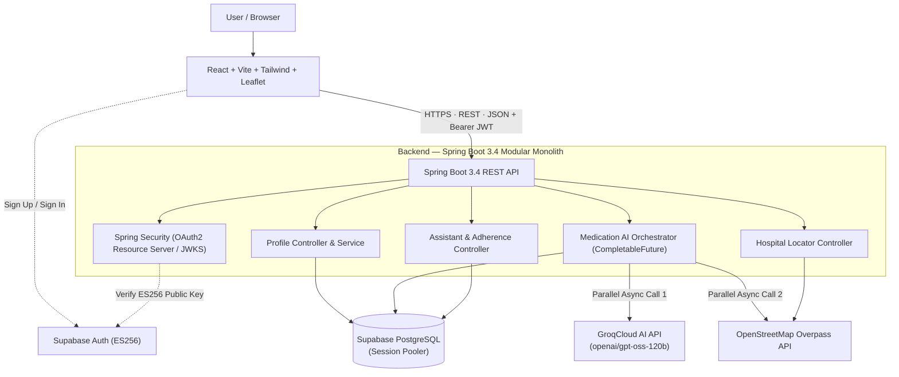
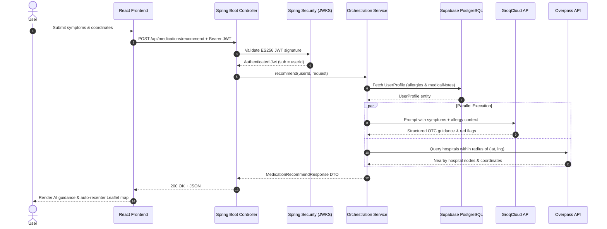
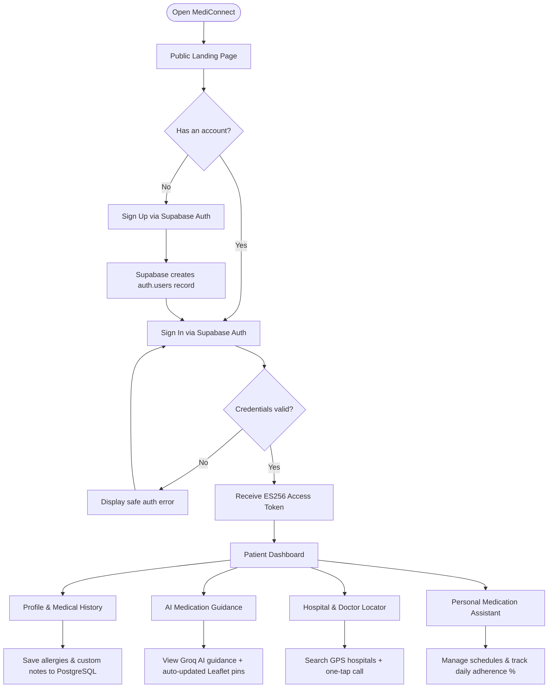
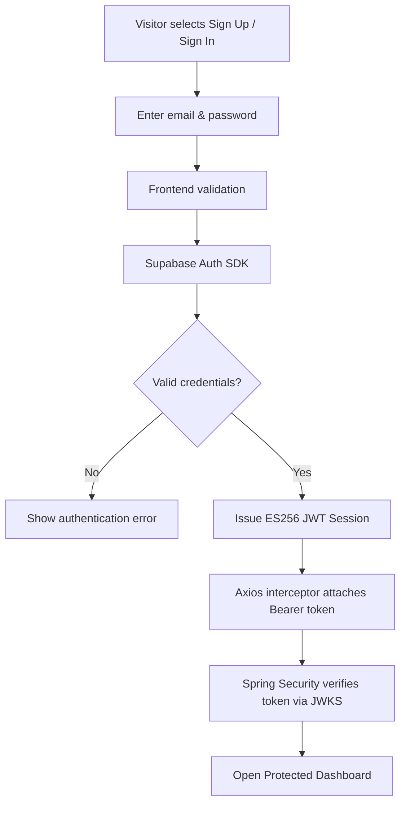
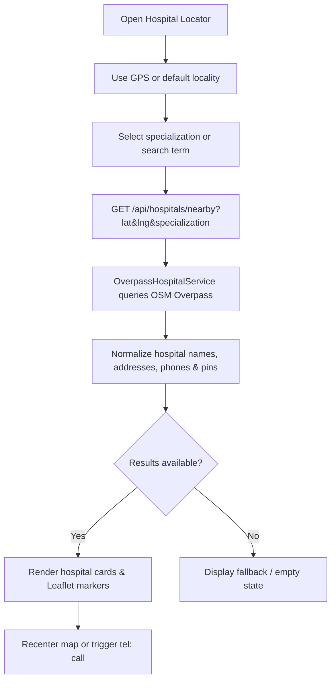
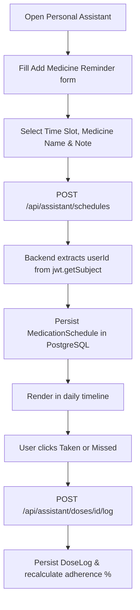
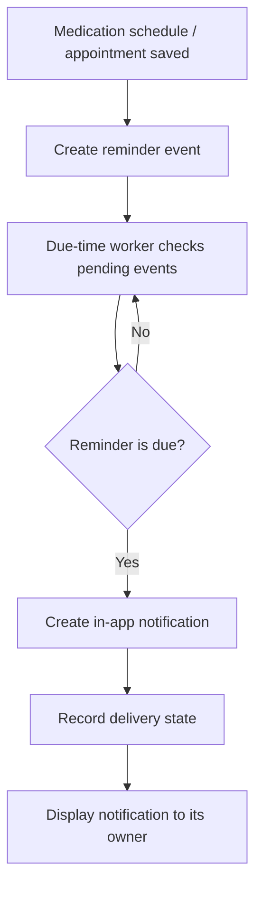
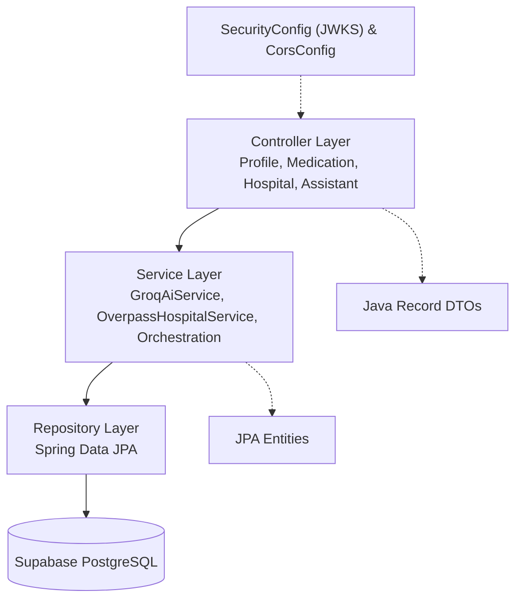
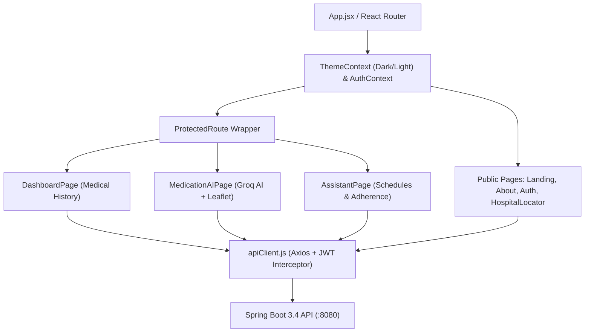
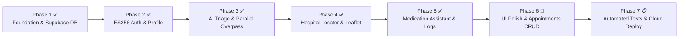

<div align="center">

# 🏥 MediConnect

### Your Healthcare Journey, Connected.

**A full-stack healthcare assistance platform for AI-contextualized medication awareness, geospatial hospital discovery, and personal medication organization.**

[](https://github.com/rishavscripts/MediConnect)
[](https://react.dev/)
[](https://spring.io/projects/spring-boot)
[](https://supabase.com/)
[](https://groq.com/)

</div>

---

> [!NOTE]
> **Project Status:** Core end-to-end architecture (React + Vite frontend, Spring Boot 3.4 REST API, Supabase Auth & PostgreSQL, GroqCloud AI triage, and OpenStreetMap/Leaflet hospital routing) is **implemented and operational**. Ongoing UI refinements and planned enhancements (such as in-app reminder notifications and full appointment CRUD) are tracked in [`Tracker.md`](Tracker.md).

## 📌 Contents

- [About the Project](#-about-the-project)
- [Problem and Goals](#-problem-and-goals)
- [Core Modules](#-core-modules)
- [User Roles](#-user-roles)
- [System Architecture](#-system-architecture)
- [End-to-End Application Workflow](#-end-to-end-application-workflow)
- [Detailed Module Workflows](#-detailed-module-workflows)
- [Backend Architecture](#-backend-architecture)
- [Frontend Architecture](#-frontend-architecture)
- [Database Design](#-database-design)
- [API Design](#-api-design)
- [Security and Privacy](#-security-and-privacy)
- [Technology Stack](#-technology-stack)
- [Repository Structure](#-repository-structure)
- [Getting Started](#-getting-started)
- [Configuration](#-configuration)
- [Testing Strategy](#-testing-strategy)
- [Development Roadmap](#-development-roadmap)
- [Project Documentation](#-project-documentation)
- [Contributing](#-contributing)
- [Healthcare Disclaimer](#-healthcare-disclaimer)

---

<details>
<summary><strong>✨ Quick Project Summary — Click to Expand</strong></summary>

<br>

| Area | Description |
| :--- | :--- |
| **Product** | Full-stack healthcare assistance & medication organization web application |
| **Frontend** | React 18, Vite, Tailwind CSS, React Router, Axios, React-Leaflet |
| **Backend** | Java 21, Spring Boot 3.4, Spring Security (OAuth2 Resource Server), Spring Data JPA |
| **Database & Auth** | Supabase Cloud PostgreSQL (Session Pooler) + Supabase Auth (ES256 JWKS) |
| **AI & Geospatial** | GroqCloud Chat Completions API (`openai/gpt-oss-120b`) + OpenStreetMap Overpass API |
| **API Communication** | Stateless REST + JSON under `/api` with Bearer JWT authentication |
| **Architecture** | Modular Monolith with parallel `CompletableFuture` external API orchestration |
| **Developer** | Rishav Mitra (`rishavscripts@gmail.com`) |

</details>

---

## 🌐 About the Project

**MediConnect** is a healthcare assistance platform designed to bring everyday healthcare-management workflows into one accessible, responsive application—complete with a global Dark/Light theme toggle.

Users can:

1. Access general, profile-contextualized medication and symptom guidance powered by GroqCloud AI with clear clinical red-flag warnings.
2. Discover nearby hospitals and clinics using GPS or locality filters on an interactive OpenStreetMap / Leaflet map with one-tap emergency calling.
3. Organize daily medication schedules (`Morning`, `Afternoon`, `Evening`) according to instructions provided by a qualified healthcare professional.
4. Track scheduled doses (`TAKEN` / `MISSED`) with live daily adherence percentages and manage check-up appointments.
5. Maintain a personal medical profile containing blood group, allergies, chronic conditions, and custom health notes.

The application is an **assistance and organization tool**. It is not intended to replace a doctor, pharmacist, emergency service, diagnosis, or prescription.

---

## 🎯 Problem and Goals

Healthcare-related information, local hospital contacts, and personal medication reminders are often scattered across different applications, websites, and notes. MediConnect provides a single, unified workspace for these workflows.

### Product Goals

- Provide a clean, responsive, and accessible user experience with Dark/Light mode support.
- Support secure registration, authentication, and profile management via Supabase Auth & ES256 JWT verification.
- Present medication information contextualized against the user's saved allergies and medical notes, with clear safety limitations.
- Help users discover nearby hospitals and specializations via real-time OpenStreetMap Overpass queries and interactive Leaflet pins.
- Simplify organizing existing medication instructions, daily adherence logs, and check-up appointments.
- Protect personal health information through strict `jwt.getSubject()` ownership checks and environment-isolated credentials.

---

## 🧩 Core Modules

### 1. AI Medication Assistance (`/medication-ai`)

Provides general medication-related information, OTC awareness, and symptom triage guidance powered by **GroqCloud AI** (`openai/gpt-oss-120b`), enriched with the patient's saved allergies and medical notes, alongside synchronized hospital pins.

- **Implemented Workflow:**
  1. User opens **Medication AI** and submits symptoms or a medication question.
  2. The frontend displays a persistent disclaimer stating that results are informational and not a medical diagnosis.
  3. The Spring Boot backend fetches the authenticated user's `UserProfile` (allergies, chronic conditions, custom notes).
  4. Using Java `CompletableFuture`, the backend executes **GroqCloud AI inference** and an **OpenStreetMap Overpass hospital lookup** in parallel.
  5. The frontend renders structured guidance, allergy cautions, clinical red-flag advice, and auto-recenters the Leaflet map to nearby facilities.
- **Safety Boundaries:**
  - No autonomous clinical diagnosis.
  - No autonomous prescriptions or personalized dosage calculations.
  - Allergy warnings and urgent-care escalation guidance remain prominent.

### 2. Hospital & Doctor Discovery (`/hospitals`)

Helps users locate nearby hospitals and healthcare centers using browser geolocation or locality/specialization filters.

- **Implemented Capabilities:**
  - Detect user coordinates via GPS (`navigator.geolocation`) or default to Kolkata / Panihati coordinates.
  - Query live OpenStreetMap hospital/clinic nodes via `/api/hospitals/nearby` (`lat`, `lng`, `specialization`).
  - Filter results by facility name, address, or specialization (`General Medicine`, `Cardiology`, `Neurology`, `Orthopedics`).
  - View interactive Leaflet map markers with popups and initiate direct `tel:` phone calls.

### 3. Personal Medication Assistant & Adherence Tracker (`/assistant`)

Helps users organize daily medication schedules based on clinician-supplied instructions and monitor daily adherence.

- **Implemented Capabilities:**
  - Create medication reminders categorized by time slot (`Morning`, `Afternoon`, `Evening`) with dosage and meal instructions.
  - Mark daily doses as `TAKEN` or `MISSED`.
  - Automatically compute today's adherence percentage (`takenCount / totalScheduled`) via `/api/assistant/adherence`.
  - View upcoming doctor check-up appointments.
- **Important:** MediConnect records instructions supplied by the user; it never calculates or silently alters prescribed dosages.

### 4. Patient Health Profile & Dashboard (`/dashboard`)

Provides first-time onboarding and ongoing management of personal health context (age, gender, blood group, known allergies, chronic conditions, and a free-form medical notes box) persisted in Supabase PostgreSQL.

---

## 👥 User Roles

| Role | Access Scope |
| :--- | :--- |
| **Visitor** | Public Landing page (`/`), About & Contact (`/about`), Hospital Locator (`/hospitals`), Health Check (`/api/health`), Sign Up & Login (`/auth`) |
| **Patient (Authenticated)** | Own health profile (`/dashboard`), AI Medication Assistant (`/medication-ai`), Personal Medication Schedules & Dose Logs (`/assistant`), and check-up appointments |
| **Administrator** | Restricted to explicitly authorized platform-management functions following the principle of least privilege (no default access to patient medical records) |

---

## 🏗️ System Architecture

MediConnect follows a **modular monolith** architecture. The React + Vite frontend and Spring Boot 3.4 backend are decoupled applications communicating over REST + JSON, while Supabase provides managed PostgreSQL persistence and ES256 asymmetric JWT authentication.



### Architecture Principles

- **Separation of Concerns:** UI rendering, HTTP routing, business orchestration, external API clients, and JPA persistence are strictly layered.
- **Parallel External Orchestration:** `MedicationOrchestrationService` uses `CompletableFuture.allOf(...)` so GroqCloud LLM inference and OpenStreetMap Overpass queries run concurrently rather than sequentially.
- **Zero-Trust Identity Verification:** Spring Security validates incoming Supabase JWTs against `SUPABASE_JWKS_URI` and extracts the user UUID directly from `jwt.getSubject()`.
- **Centralized Configuration:** All environment-specific endpoints and keys live in `.env` files (`spring.config.import` on the backend, `import.meta.env` on the frontend) with zero hardcoded secrets.

### Request Lifecycle (AI Medication Triage)



---

## 🔄 End-to-End Application Workflow



---

## 🔍 Detailed Module Workflows

### 1. Registration and Login (Supabase Auth + JWKS)



### 2. Hospital and Doctor Discovery



### 3. Add and Manage a Medication Schedule



### 4. Planned Notification Lifecycle

> In-app reminders are planned as an upcoming enhancement. Email and push notification integrations are outside the current implementation scope.



---

## ⚙️ Backend Architecture

The backend is structured as a layered **Spring Boot 3.4** application inside `backend/src/main/java/com/mediconnect/backend/`:



### Package & Layer Responsibilities

| Package | Responsibility |
| :--- | :--- |
| `config` | `SecurityConfig` (stateless JWT resource server, public vs. protected routes) and `CorsConfig` (restricts origins to `FRONTEND_URL`) |
| `controller` | `ProfileController`, `MedicationController`, `HospitalController`, and `AssistantController` mapping REST endpoints under `/api` |
| `dto` | Strongly typed Java `record` DTOs (`HealthStatus`, `AdherenceSummary`, `MedicationRecommendRequest`, `MedicationRecommendResponse`, `HospitalPin`) |
| `service` | `GroqAiService`, `OverpassHospitalService`, and `MedicationOrchestrationService` (`CompletableFuture` parallel execution) |
| `repository` | Spring Data JPA interfaces (`UserProfileRepository`, `MedicationScheduleRepository`, `DoseLogRepository`, `AppointmentRepository`) |
| `entity` | JPA entities mapped to `public.profiles`, `public.schedules`, `public.dose_logs`, and `public.appointments` |

---

## 🖥️ Frontend Architecture

The frontend is built with **React**, **Vite**, and **Tailwind CSS** inside `frontend/src/`:



### Frontend Responsibilities

- **Centralized HTTP Client (`src/api/apiClient.js`):** Reads `VITE_API_BASE_URL` and automatically injects the active Supabase session `access_token` into `Authorization: Bearer <token>` headers.
- **Global Theme Management (`src/context/ThemeContext.jsx`):** Persists Dark/Light mode preferences across sessions.
- **Route Protection (`src/components/ProtectedRoute.jsx`):** Redirects unauthenticated visitors attempting to access protected clinical views to `/auth`.
- **Interactive Geospatial UI (`react-leaflet`):** Dynamically recenters maps when user GPS coordinates, hospital selections, or AI triage results update.

---

## 🗄️ Database Design

MediConnect uses **Supabase PostgreSQL** (connected via Session Pooler on port `5432`). Every user-owned table references `auth.users(id)` with `ON DELETE CASCADE`.

```mermaid
erDiagram
    AUTH_USERS ||--o| PROFILES : has
    AUTH_USERS ||--o{ SCHEDULES : owns
    SCHEDULES ||--o{ DOSE_LOGS : tracks
    AUTH_USERS ||--o{ DOSE_LOGS : logs
    AUTH_USERS ||--o{ APPOINTMENTS : books

    AUTH_USERS {
        uuid id PK
        string email
    }
    PROFILES {
        uuid id PK_FK
        string full_name
        int age
        string gender
        string blood_group
        text allergies
        text chronic_conditions
        text medical_notes
        timestamptz updated_at
    }
    SCHEDULES {
        uuid id PK
        uuid user_id FK
        string time_slot
        string medicine_name
        text note
        boolean is_active
        timestamptz created_at
    }
    DOSE_LOGS {
        uuid id PK
        uuid schedule_id FK
        uuid user_id FK
        date log_date
        string status
        timestamptz logged_at
    }
    APPOINTMENTS {
        uuid id PK
        uuid user_id FK
        string doctor_name
        string specialization
        string clinic_address
        timestamptz appointment_time
        string status
    }
```

### Main Tables

| Table | Purpose |
| :--- | :--- |
| `public.profiles` | Patient demographics, blood group, allergies, chronic conditions, and custom medical notes (`id` matches `auth.users.id`) |
| `public.schedules` | Active daily medication reminders (`time_slot`, `medicine_name`, `note`, `is_active`) |
| `public.dose_logs` | Daily adherence records (`TAKEN` / `MISSED`) linked to `schedule_id` and `log_date` |
| `public.appointments` | Upcoming doctor check-up appointments (`doctor_name`, `specialization`, `clinic_address`, `appointment_time`, `status`) |

---

## 🔌 API Design

All endpoints are served under the `/api` prefix:

| Module | Method | Endpoint | Auth | Purpose |
| :--- | :--- | :--- | :--- | :--- |
| **System** | `GET` | `/api/health` | Public | Returns service status (`{"status":"UP","service":"MediConnect Spring Boot 3.4"}`) |
| **Discovery** | `GET` | `/api/hospitals/nearby` | Public | Queries nearby hospitals via OpenStreetMap Overpass (`lat`, `lng`, `specialization`) |
| **Profile** | `GET` | `/api/profile` | Bearer JWT | Retrieves the authenticated user's medical profile |
| **Profile** | `PUT` | `/api/profile` | Bearer JWT | Creates or updates allergies, conditions, and custom medical notes |
| **Medication AI** | `POST` | `/api/medications/recommend` | Bearer JWT | Runs parallel GroqCloud AI guidance + Overpass hospital discovery |
| **Assistant** | `GET` | `/api/assistant/schedules` | Bearer JWT | Lists active medication schedules for the authenticated user |
| **Assistant** | `POST` | `/api/assistant/schedules` | Bearer JWT | Adds a new medication reminder schedule |
| **Assistant** | `POST` | `/api/assistant/doses/{id}/log` | Bearer JWT | Logs a daily dose as `TAKEN` or `MISSED` |
| **Assistant** | `GET` | `/api/assistant/adherence` | Bearer JWT | Returns today's adherence percentage, counts, and dose logs |

---

## 🔐 Security and Privacy

- **Asymmetric ES256 JWT Verification:** Spring Security OAuth2 Resource Server validates every protected request against Supabase's public JWKS endpoint (`SUPABASE_JWKS_URI`).
- **IDOR Prevention:** User identity is derived exclusively from `jwt.getSubject()` on the server; client requests cannot spoof another user's UUID.
- **Secret Isolation:** Database credentials, Supabase keys, and GroqCloud API keys are stored strictly in `.env` files ignored by Git.
- **Strict CORS Policy:** Cross-origin requests are restricted to the configured `FRONTEND_URL` (`http://localhost:5173` in local development).
- **Server-Side AI Keys:** `GROQ_API_KEY` remains exclusively on the Spring Boot backend and is never exposed to the browser bundle.

---

## 🧰 Technology Stack

| Layer | Technology | Purpose |
| :--- | :--- | :--- |
| **Frontend** | React 18 + Vite | Component-based single-page application |
| **Styling** | Tailwind CSS + Lucide Icons | Responsive clinical UI with Dark/Light mode |
| **Maps** | React-Leaflet + OpenStreetMap | Interactive hospital markers and map auto-recentering |
| **Backend** | Java 21 + Spring Boot 3.4 | Modular monolith REST API & async orchestration |
| **Security** | Spring Security + Supabase Auth | ES256 JWKS token validation & RBAC |
| **Persistence** | Spring Data JPA / Hibernate | Relational ORM with schema validation |
| **Database** | Supabase PostgreSQL | Managed cloud PostgreSQL via Session Pooler |
| **AI Inference** | GroqCloud (`openai/gpt-oss-120b`) | Low-latency clinical triage & OTC guidance |
| **Geospatial Data** | OpenStreetMap Overpass API | Real-time nearby hospital & clinic lookup |

---

## 📁 Repository Structure

```text
MediConnect/
│
├── backend/                              # Spring Boot 3.4 REST API
│   ├── src/main/java/com/mediconnect/backend/
│   │   ├── config/                       # SecurityConfig (JWKS) & CorsConfig
│   │   ├── controller/                   # REST Controllers (/api/*)
│   │   ├── dto/                          # Java Record DTOs
│   │   ├── entity/                       # JPA Entities
│   │   ├── repository/                   # Spring Data JPA Repositories
│   │   └── service/                      # GroqAI, Overpass & Orchestration Services
│   ├── src/main/resources/
│   │   └── application.properties        # Native spring.config.import & datasource config
│   ├── .env.example                      # Safe backend env template
│   ├── pom.xml                           # Maven dependencies
│   └── README.md                         # Backend setup & DDL guide
│
├── frontend/                             # React + Vite Client Application
│   ├── src/
│   │   ├── api/                          # Axios client with Bearer JWT interceptor
│   │   ├── components/                   # Navbar, Footer, ProtectedRoute
│   │   ├── context/                      # AuthContext & ThemeContext
│   │   └── pages/                        # Landing, Auth, Dashboard, MedicationAI, HospitalLocator, Assistant, About
│   ├── .env.example                      # Safe frontend env template
│   ├── package.json                      # NPM dependencies
│   └── README.md                         # Frontend setup guide
│
├── GEMINI.md                             # AI-assisted development context
├── PRD.md                                # Product requirements and scope
├── TechSpec.md                           # Technical architecture and conventions
├── AppFlow.md                            # User journeys and application workflows
├── Design.md                             # UI and design-system guidance
├── Schema.md                             # Database schema documentation
├── Tracker.md                            # Development progress and tasks
├── Rules.md                              # Project rules and implementation constraints
├── .gitignore                            # Excludes .env, node_modules, target/
└── README.md                             # Root project documentation
```

---

## 🚀 Getting Started

### Prerequisites

- **Git**
- **Java 21+** and **Maven** (or included `./mvnw` wrapper)
- **Node.js 18+ (LTS)** and **npm**
- **Supabase Project** (PostgreSQL + Auth) & **GroqCloud API Key**

### 1. Clone the Repository

```bash
git clone https://github.com/rishavscripts/MediConnect.git
cd MediConnect
```

### 2. Initialize Supabase Database

1. Open your **Supabase Dashboard → SQL Editor**.
2. Create the required tables (`public.profiles`, `public.schedules`, `public.dose_logs`, `public.appointments`) using the DDL in [`backend/README.md`](backend/README.md).
3. Copy your **Session Pooler** JDBC URL (`port 5432`) and **JWKS URI** (`https://<project-ref>.supabase.co/auth/v1/.well-known/jwks.json`).

### 3. Configure and Start the Backend (`port 8080`)

```bash
cd backend
cp .env.example .env
# Populate SUPABASE_DB_URL, SUPABASE_DB_USERNAME, SUPABASE_DB_PASSWORD, SUPABASE_JWKS_URI, and GROQ_API_KEY

# Windows
mvnw.cmd spring-boot:run

# macOS / Linux
./mvnw spring-boot:run
```

Verify the server is live at `http://localhost:8080/api/health` → `{"status":"UP","service":"MediConnect Spring Boot 3.4"}`.

### 4. Configure and Start the Frontend (`port 5173`)

Open a second terminal:

```bash
cd frontend
cp .env.example .env
# Populate VITE_API_BASE_URL, VITE_SUPABASE_URL, and VITE_SUPABASE_ANON_KEY

npm install
npm run dev
```

Open `http://localhost:5173` in your browser.

---

## ⚙️ Configuration

### Backend (`backend/.env`)

| Variable | Purpose | Example |
| :--- | :--- | :--- |
| `SERVER_PORT` | Spring Boot HTTP port | `8080` |
| `FRONTEND_URL` | Allowed CORS origin | `http://localhost:5173` |
| `SUPABASE_DB_URL` | Supabase Session Pooler JDBC URL | `jdbc:postgresql://aws-0-<region>.pooler.supabase.com:5432/postgres` |
| `SUPABASE_DB_USERNAME` | Pooler database user | `postgres.<project-ref>` |
| `SUPABASE_DB_PASSWORD` | Supabase database password | Keep private |
| `SUPABASE_JWKS_URI` | Supabase ES256 public key set URL | `https://<project-ref>.supabase.co/auth/v1/.well-known/jwks.json` |
| `GROQ_API_KEY` | GroqCloud API secret key | `gsk_...` |
| `GROQ_API_URL` | Groq chat completions endpoint | `https://api.groq.com/openai/v1/chat/completions` |
| `GROQ_MODEL` | LLM model identifier | `openai/gpt-oss-120b` |
| `OVERPASS_API_URL` | OpenStreetMap Overpass interpreter | `https://overpass-api.de/api/interpreter` |

### Frontend (`frontend/.env`)

| Variable | Purpose | Example |
| :--- | :--- | :--- |
| `VITE_API_BASE_URL` | Spring Boot backend base URL | `http://localhost:8080` |
| `VITE_SUPABASE_URL` | Supabase project URL | `https://<project-ref>.supabase.co` |
| `VITE_SUPABASE_ANON_KEY` | Supabase public anonymous key | `eyJ...` |

**Environment Hygiene Checklist**

- Keep `.env` files out of Git (`.gitignore` already ignores `*.env` / `.env`).
- Maintain `.env.example` templates with placeholder values only.
- Never paste real API keys or database passwords into commits, issues, or documentation.

---

## 🧪 Testing Strategy

### Backend Verification Checklist

- [x] Verify `/api/health` returns HTTP `200 OK`.
- [x] Verify HikariCP connects cleanly to Supabase PostgreSQL with `ddl-auto=validate`.
- [x] Verify unauthenticated requests to `/api/profile`, `/api/medications/**`, and `/api/assistant/**` return `401 Unauthorized`.
- [x] Verify valid Supabase ES256 Bearer JWTs resolve `jwt.getSubject()` accurately.
- [ ] Add JUnit / Mockito unit tests for `MedicationOrchestrationService` and `AssistantController`.
- [ ] Add integration tests verifying cross-user IDOR isolation.

### Frontend & End-to-End Acceptance Checklist

- [x] Visitor can browse Landing, About, and Hospital Locator without logging in.
- [x] User can register and sign in via Supabase Auth.
- [x] User can save allergies and custom medical notes on Dashboard and reload persisted values.
- [x] Submitting symptoms on Medication AI displays GroqCloud guidance and auto-updates Leaflet hospital pins.
- [x] Adding a medication reminder and logging `TAKEN` / `MISSED` updates today's adherence percentage.
- [x] Dark/Light theme toggle switches cleanly across all pages.

---

## 🗺️ Development Roadmap



| Phase | Focus | Status |
| :--- | :--- | :--- |
| **Phase 1** | Repository setup, Spring Boot 3.4 + React Vite scaffolding, Supabase PostgreSQL connection | ✅ Completed |
| **Phase 2** | Supabase Auth integration, ES256 JWKS verification, Patient Dashboard & medical profile CRUD | ✅ Completed |
| **Phase 3** | GroqCloud AI integration + parallel `CompletableFuture` Overpass hospital lookup | ✅ Completed |
| **Phase 4** | GPS-enabled Hospital Locator with specialization filters, Leaflet pins & `tel:` calling | ✅ Completed |
| **Phase 5** | Personal Medication Assistant, schedule creation, `TAKEN`/`MISSED` logging & adherence % | ✅ Completed |
| **Phase 6** | Dynamic appointment CRUD, UI refinements, and enhanced error states | 🔄 In Progress |
| **Phase 7** | Automated JUnit/Vitest suites and cloud deployment (Render/Railway + Vercel) | 📋 Planned |

---

## 📚 Project Documentation

| Document | What It Covers |
| :--- | :--- |
| [`PRD.md`](PRD.md) | Product vision, goals, scope, requirements, and safety boundaries |
| [`TechSpec.md`](TechSpec.md) | Technical stack, modular architecture, and API conventions |
| [`AppFlow.md`](AppFlow.md) | Actors, user journeys, module workflows, and route access |
| [`Schema.md`](Schema.md) | Relational data model and Supabase PostgreSQL relationships |
| [`Design.md`](Design.md) | Visual language, Dark/Light UI patterns, and responsive behavior |
| [`Tracker.md`](Tracker.md) | Implementation progress, completed milestones, and upcoming tasks |
| [`Rules.md`](Rules.md) | Project-wide development and security constraints |
| [`GEMINI.md`](GEMINI.md) | Context and instructions for AI-assisted development |

---

## 🤝 Contributing

Contributions and suggestions are welcome:

1. Fork the repository.
2. Create a feature branch: `git checkout -b feature/your-feature`.
3. Ensure `.env` files are excluded and follow the project's security rules.
4. Update documentation if endpoints, workflows, or database tables change.
5. Commit with a clear message and open a Pull Request.

---

## 🩺 Healthcare Disclaimer

MediConnect is intended solely for healthcare assistance, personal medication organization, and facility discovery. It does **not** provide medical diagnoses, prescribe medications, calculate personalized dosages, or replace advice from qualified healthcare professionals. Always follow your clinician's instructions and consult a licensed physician or pharmacist regarding medical questions. In case of a medical emergency, contact local emergency services immediately.

---

<div align="center">

**Built by [Rishav Mitra](https://github.com/rishavscripts) (`rishavscripts@gmail.com`) to make everyday healthcare management more organized and connected.**

[⬆ Back to Top](#-mediconnect)

</div>